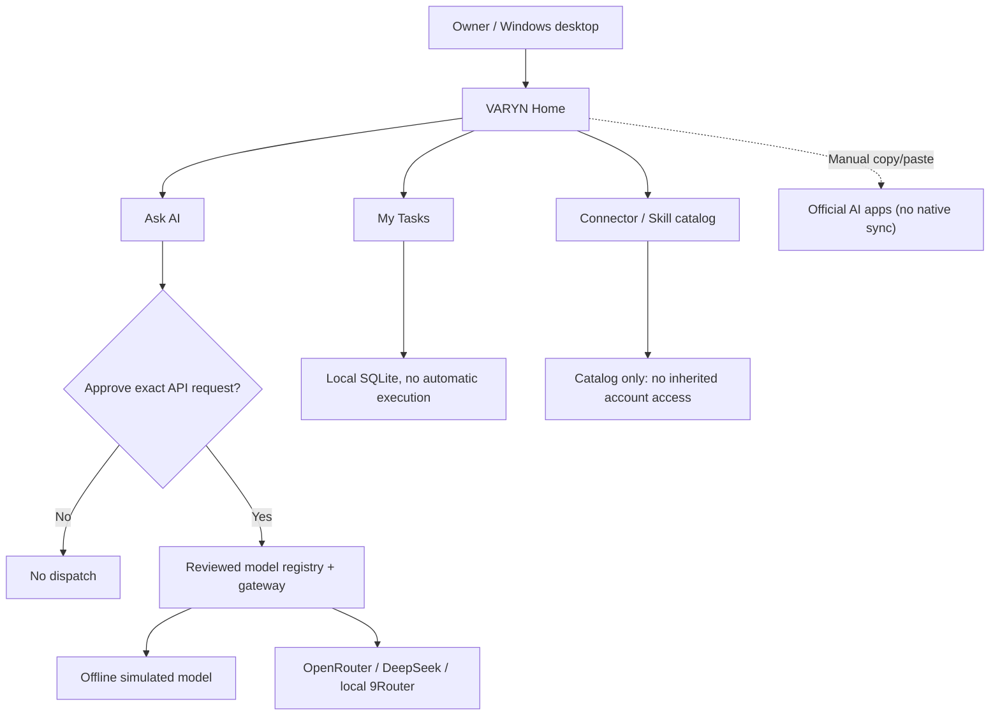

# VARYN

**A local-first AI workspace with human-approved model routing, persistent tasks, and experimental multi-model workflows.**

[](https://github.com/naraya07pedro-spec/VARYN/releases/tag/v0.1.0-alpha.3)
[](https://github.com/naraya07pedro-spec/VARYN/actions/runs/42189377997)
[](LICENSE)


> **Public experimental alpha, not production software.** VARYN currently provides a Windows portable desktop, an owner-approved single-request LLM gateway, a local task tracker, and a directory of possible integrations. It does **not** yet offer autonomous task execution, connected third-party app accounts, or native two-way ChatGPT/Claude/Gemini consumer-chat synchronization.

### [Download Windows Alpha 3](https://github.com/naraya07pedro-spec/VARYN/releases/download/v0.1.0-alpha.3/VARYN-Windows-x64-v0.1.0-alpha.3-unsigned.zip) · [Release notes](https://github.com/naraya07pedro-spec/VARYN/releases/tag/v0.1.0-alpha.3) · [Browse full alpha source](https://github.com/naraya07pedro-spec/VARYN/tree/v0.1.0-alpha.3) · [Development PR](https://github.com/naraya07pedro-spec/VARYN/pull/1)

## Why VARYN?

Working with multiple AI models raises practical questions: What data is leaving the machine? Which model is selected? What might a request cost? Which tasks and permissions belong to the owner? VARYN explores these problems as an open-source desktop project, without claiming to control accounts or tools it has not actually connected.

## What works in Alpha 3

| Capability | Current implementation |
| --- | --- |
| **Ask AI** | Start on a simple chat screen; choose a provider, type a message, and send **one** owner-approved request to a selected OpenRouter or DeepSeek API model, or authorized local 9Router; requires your own API credentials and per-request approval |
| **Offline mode** | Test a clearly labeled simulated response without an API key or real model billing |
| **My Tasks** | Create, list, complete, pause, and cancel tasks in local SQLite, with no fixed application-wide item count limit |
| **Due status** | Refreshes while the Windows app is running; **does not** execute tasks, issue notifications, or run when the PC is off |
| **Connectors / Skills directory** | Lists 15 connector candidates, 7 plugin candidates, and 16 skill candidates. They are **catalog entries, NOT authenticated or executable integrations** |
| **Manual AI-app handoff** | Owner-mediated copy/paste workflows across official AI apps, **not** synchronization of chat histories |
| **Portable Windows build** | Unsigned Windows x64 ZIP with Python runtime included, created by GitHub Actions |

The project also contains research prototypes for local memory, permission controls, scoped tools, and recovery. Those prototypes are **not** a finished unified autonomous agent.

## Get started on Windows

1. **[Download VARYN v0.1.0-alpha.3 for Windows x64](https://github.com/naraya07pedro-spec/VARYN/releases/download/v0.1.0-alpha.3/VARYN-Windows-x64-v0.1.0-alpha.3-unsigned.zip)** (experimental, approximately 14 MB).
2. Verify the downloaded **ZIP SHA-256** (this hash is for the ZIP, not the EXE):

   ```powershell
   (Get-FileHash .\VARYN-Windows-x64-v0.1.0-alpha.3-unsigned.zip -Algorithm SHA256).Hash.ToLowerInvariant()
   ```

   Expected value: `2e1d857f4a4a06db2072794dd95641f02706b7baaa9d8223172e2bce685caed3`.

3. Extract the **entire archive**, keeping `VARYN-Portable.exe`, `_internal/`, `BUNDLE-SHA256.json`, and `Start-VARYN-OwnerPilot.ps1` together.
4. Open **non-administrator** PowerShell in the extracted `VARYN-Portable` directory. Verify and start in offline mode:

   ```powershell
   powershell.exe -NoProfile -File .\Start-VARYN-OwnerPilot.ps1 -VerifyOnly
   powershell.exe -NoProfile -File .\Start-VARYN-OwnerPilot.ps1 -Provider offline
   ```

5. VARYN opens on **Chat**, with a message box and Send button. **My Tasks** and **Connectors / Skills** remain available. For a real provider request, relaunch with `-Provider openrouter` or `-Provider deepseek`, enter your **own** API key locally, register/review an eligible provider model and current prices, and approve the exact request inside VARYN.

**Safety:** The executable and PowerShell launcher are **unsigned**. Do not disable Windows Defender or SmartScreen to run them. No customer data, private conversation archives, or sensitive credentials should be used in this experimental build. Request price estimates are **not** provider-enforced spending caps. The first real authenticated external model request has not been independently verified on the author's own PC.

## How it fits together



## Architecture, development, and contributing

**Why does `main` only contain the project entry point?** The full experimental implementation was developed on a long-running **draft PR #1** and is preserved in the **[v0.1.0-alpha.3 release tag](https://github.com/naraya07pedro-spec/VARYN/tree/v0.1.0-alpha.3)**. A public release does **not** imply that all experimental work has been merged into the default branch. To inspect or build the app source, select the release tag rather than cloning the `main` stub.

- [Architecture and trust boundaries](https://github.com/naraya07pedro-spec/VARYN/blob/v0.1.0-alpha.3/docs/ARCHITECTURE.md)
- [Task, connector, plugin, and skill limitations](https://github.com/naraya07pedro-spec/VARYN/blob/v0.1.0-alpha.3/docs/TASKS-CONNECTORS-SKILLS.md)
- [Alpha 3 owner setup and product scope](https://github.com/naraya07pedro-spec/VARYN/blob/v0.1.0-alpha.3/docs/OWNER-HOME-ALPHA2.md)
- [Contribution guidelines](https://github.com/naraya07pedro-spec/VARYN/blob/v0.1.0-alpha.3/CONTRIBUTING.md) and [security policy](https://github.com/naraya07pedro-spec/VARYN/blob/v0.1.0-alpha.3/SECURITY.md)
- [Verified Windows + Ubuntu + Portable + Release pipeline](https://github.com/naraya07pedro-spec/VARYN/actions/runs/42189377997)
- [Report a reproducible issue](https://github.com/naraya07pedro-spec/VARYN/issues)

## Roadmap

**Next meaningful milestones:** first verified owner-PC model call, scoped real OAuth connectors, task-to-tool execution with durable idempotent checkpoints, and honest end-to-end demonstrations. Automatic two-way conversation-history synchronization in consumer AI apps remains **externally unverified**, not a shipped capability.

If the project's implementation or permission model interests you, **star the repository to follow its progress**. Real installation feedback and reproducible issues are more useful than artificial engagement.

**Author:** Evan Naraya · **License:** [MIT](LICENSE). VARYN is independent and is not affiliated with OpenAI, Anthropic, Google, OpenRouter, or other integration providers.
