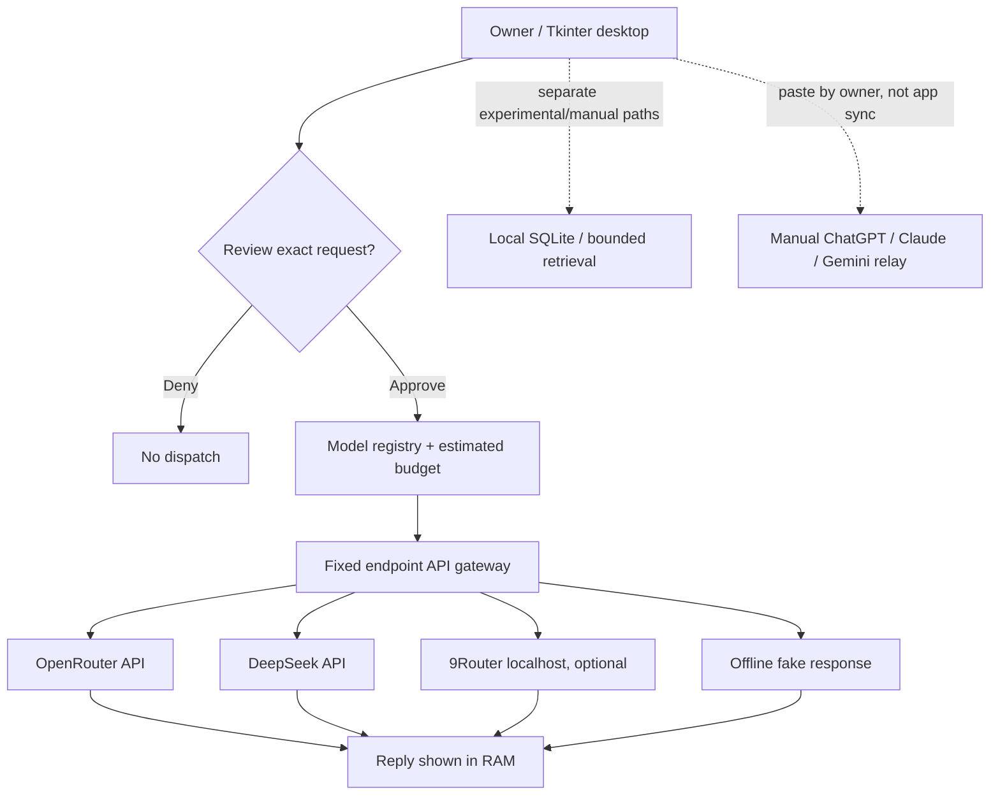

# VARYN

**Local-first, experimental personal AI workspace.**  
Owner-approved model API requests, manual multi-AI handoffs, and prototype local memory tools. Built with Python and Tkinter.

[](https://github.com/naraya07pedro-spec/VARYN/actions/workflows/memory-checks.yml) [MIT License](LICENSE) · [Security](SECURITY.md) · [Contributing](CONTRIBUTING.md)

> **Development status, November 6, 2026:** This repository's `main` branch contains the original project stub. The **working experimental source code is on [draft PR #1](https://github.com/naraya07pedro-spec/VARYN/pull/1)**. This README is part of that draft and is not a stable public release. VARYN is **not** production-safe or a fully autonomous agent. No native two-way synchronization with consumer ChatGPT, Claude, or Gemini accounts.

## What you can try today

| Area | Current scope |
| --- | --- |
| Windows x64 desktop | Unsigned, single-folder Portable build created by GitHub-hosted Windows CI |
| Ask an AI model | One owner-typed request at a time; OpenRouter / DeepSeek / authorized local 9Router with independent API credentials and explicit review |
| Offline preview | Fake-model simulation, quote comparison, and model request inspection |
| Personal memory | Experimental local SQLite components and bounded retrieval; not automatic cross-provider memory |
| Three-provider collaboration | User-mediated manual ChatGPT → Claude → Gemini handoffs with review and pasted replies |
| Local agent/tool research | Isolated prototypes and synthetic consent / recovery experiments; **not** a production assistant with unrestricted tools |

**Important:** A green CI run tests code and a hosted Windows GUI. It does **not** prove an external model account was authenticated or that the binary was accepted on your PC. API traffic may incur real charges. Price quotes are estimates, **not billing caps**.

## Quick start: Windows Portable (experimental)

1. Download the **[public v0.1.0-alpha.1 experimental Windows ZIP](https://github.com/naraya07pedro-spec/VARYN/releases/download/v0.1.0-alpha.1/VARYN-Windows-x64-v0.1.0-alpha.1-unsigned.zip)**. This is an UNSIGNED pre-release built from commit `ac547f15c6db10fd25754cb4e0e2bbdce8d12906`, not a stable software release.
2. Confirm the **downloaded release ZIP SHA-256** equals `dbd81452b9af7322da201979bcc2a92112b8bd8c67994ad76938c0498bc3b162`. This is the ZIP archive's checksum, not the contained executable's hash.
3. Extract the **entire folder**, keeping `VARYN-Portable.exe`, `_internal/`, `BUNDLE-SHA256.json`, and `Start-VARYN-OwnerPilot.ps1` together. Run as a **normal, non-administrator** Windows user.
4. From the extracted folder in PowerShell, optionally verify the embedded file manifest, then launch the *offline* mode:

   ```powershell
   powershell.exe -NoProfile -File .\Start-VARYN-OwnerPilot.ps1 -VerifyOnly
   powershell.exe -NoProfile -File .\Start-VARYN-OwnerPilot.ps1 -Provider offline
   ```

5. In the main app, open **17S-40 | Open Model Control Center (owner opt-in)**. The fake model works without a paid model account; its reply is explicitly synthetic.
6. For an actual external AI reply, **separately** obtain your own API key, verify the provider's current model ID/prices and account eligibility, start the launcher with `-Provider openrouter` or `-Provider deepseek`, add the reviewed model quote, type your question, check the **real-task** and **one-request network** permissions, review the exact outgoing request, and approve once.

**Do not put API keys, private conversations, or customer data in issues, screenshots, or the app.** No default confidential-data protection is claimed. Do not disable Defender or SmartScreen to run an unsigned binary.

**Public GitHub pre-release is available**, but there is no stable release or production support. [Release and provenance notes](docs/RELEASE.md).

## Task and integration foundations (development branch only)

VARYN includes a **local task ledger with no hardcoded total-item cap**, indexed due-state tracking and bounded pagination, and a **read-only integration directory** for connectors, plugins and skills observed in the current ChatGPT workspace. This is **not** a promise of unlimited CPU/disk, autonomous scheduling, or inherited ChatGPT app login.

```bash
python -m varyn.integration_catalog
python -m varyn.unlimited_task_store --db ./varyn-tasks.sqlite3 add --title "Synthetic owner task"
python -m varyn.unlimited_task_store --db ./varyn-tasks.sqlite3 list
```

**Critical:** All third-party app entries are `catalog_only`, **not connected or callable**. No credentials are copied. The task ledger marks due items but never silently executes them. See [Task and integration boundaries](docs/TASKS-CONNECTORS-SKILLS.md).

## Architecture



The CLI, GUI, memory store, and manually mediated app paths are **not** one unified autonomous agent today. See [architecture and trust boundaries](docs/ARCHITECTURE.md).

## Demo and screenshots

We have **not** fabricated a desktop screenshot or GIF. [Demo capture instructions](docs/DEMO.md) describe how to record the *actual* portable Windows UI using harmless synthetic examples; images will be embedded here only when genuine recordings exist. The current CI's hosted Windows GUI validation is **not** a user-device recording.

## Safety, limitations, and support

- No supported native, automatic, two-way official consumer-app history sync. Provider APIs are separate from consumer subscriptions.
- Local SQLite and historical experiment data are **not** an audited encryption-at-rest vault.
- Human permission prompts are not equivalent to a hardened OS sandbox or comprehensive malware containment.
- A source code review, unsigned package checksums, and CI checks do not establish Windows publisher trust.
- Upstream 9Router may alter provider/model selection and billing outside VARYN's control.
- No guarantee of free inference, quoted pricing accuracy, or hard spending limits.
- Do not submit private API credentials or personal data to public issues.

[Security policy](SECURITY.md) · [Known limitations](docs/ARCHITECTURE.md) · [Detailed Windows pilot](README-PORTABLE.txt)

## Contribute and follow progress

Read [CONTRIBUTING.md](CONTRIBUTING.md) and use issue templates for reproducible bug reports or feature requests. Public experiment history is recorded in [draft PR #1](https://github.com/naraya07pedro-spec/VARYN/pull/1), with implementation docs in [docs/](docs/).

**License:** [MIT](LICENSE) © 2026 Evan Naraya. Attribution of upstream products is not a claim of affiliation or endorsement.
