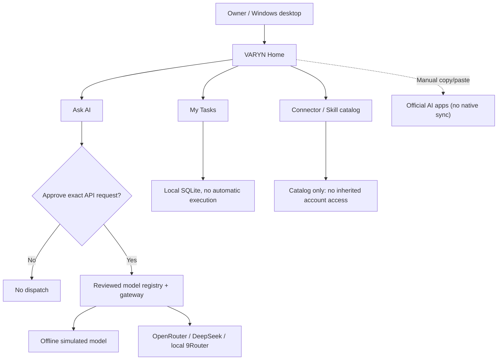

# VARYN

**A local-first AI workspace with human-approved model routing, persistent tasks, and experimental multi-model workflows.**

[](https://github.com/naraya07pedro-spec/VARYN/releases/tag/v0.1.0-alpha.7)
[](https://github.com/naraya07pedro-spec/VARYN/actions/runs/42207227626)
[](LICENSE)


> **Public experimental alpha, not production software.** VARYN provides a local Windows chat workspace, owner-approved LLM calls, a local task tracker, **explicit ChatGPT-export memory import encrypted with Windows DPAPI**, and a manually configured **owner-only Telegram Bot API channel**. All third-party credentials must be configured independently. It does **not** offer autonomous tasks, inherited ChatGPT integrations, WhatsApp connectivity, or native two-way consumer-chat synchronization.

### [Download Windows Alpha 7](https://github.com/naraya07pedro-spec/VARYN/releases/download/v0.1.0-alpha.7/VARYN-Windows-x64-v0.1.0-alpha.7-unsigned.zip) · [Release notes](https://github.com/naraya07pedro-spec/VARYN/releases/tag/v0.1.0-alpha.7) · [Browse full alpha source](https://github.com/naraya07pedro-spec/VARYN/tree/v0.1.0-alpha.7) · [Development PR](https://github.com/naraya07pedro-spec/VARYN/pull/1)

## Why VARYN?

Working with multiple AI models raises practical questions: What data is leaving the machine? Which model is selected? What might a request cost? Which tasks and permissions belong to the owner? VARYN explores these problems as an open-source desktop project, without claiming to control accounts or tools it has not actually connected.

## A natural, multilingual workspace

Based on real user-device feedback, VARYN's latest Windows home removes the previous decorative mountain banner and generic AI-themed cards. The new **warm, editorial layout** places a familiar chat composer, a clear navigation sidebar, and working task/app shortcuts ahead of technical configuration.

**English is the default UI language.** Change it directly from the header or Settings to **Bahasa Indonesia, Español, or Français**. Your choice is saved locally; existing tasks and the current chat remain open when you switch. Advanced legacy developer views and third-party replies may remain in their original language.

**Maximize and resize are supported.** Unlike the earlier window treated as a transient dialog, the Alpha 7 owner home starts maximized on Windows and has both native window controls and an obvious Maximize / Restore button. The interface uses standard system typography without downloaded images, stock illustrations or robotic visual themes.

The app remains an experimental API gateway with explicit per-request approvals; **no automatic task execution, verified third-party OAuth connectors, native consumer-chat sync, or production security guarantee** is implied.

## New in Alpha 7: working memory import and Telegram

**Memory, not pretend sync.** Open **Memory** in the left navigation, select the ChatGPT ZIP downloaded from **ChatGPT → Settings → Data controls → Export data**, choose the conversations you actually want to retain, and approve the local import. Selected plain-text excerpts are stored in a Windows-user-bound **DPAPI encrypted vault**. Use local search to find a conversation and insert a reviewed excerpt into chat, or check **Use saved memory** for a one-time retrieval before sending. Imported context is **untrusted reference material**, never automatically uploaded or treated as instructions. This pilot limits export files and vault capacity; it does not recreate your ChatGPT Memory summary, maintain always-on synchronization, or provide full semantic retrieval.

**Telegram bot, not just a catalog item.** In **Apps**, configure a bot token from Telegram **@BotFather** and your *numeric Telegram user ID*. First configure a real OpenRouter/DeepSeek model and API key locally in the chat. Press **Connect Telegram**; the desktop uses the official Telegram Bot API and will only respond to the allowlisted owner's private DM. To use a model, send `/ask Your question`, inspect the complete preview, then send `/confirm CODE` within two minutes to approve **one** request. The bot ignores unknown senders/groups and runs only **while the desktop is open**. No auto-retries or 24/7 service; external provider charges can apply. Disconnect in the application to stop polling.

**WhatsApp is NOT connected.** A real WhatsApp integration needs separate official Meta Cloud API credentials, a business-enabled number and an HTTPS webhook. VARYN does not inherit messaging accounts from ChatGPT or Hermes.

[Implementation scope, privacy constraints and setup instructions](https://github.com/naraya07pedro-spec/VARYN/blob/v0.1.0-alpha.7/docs/OWNER-MEMORY-TELEGRAM.md)

## What works in Alpha 7

| Capability | Current implementation |
| --- | --- |
| **Ask AI** | Everyday English-first home with simple chat, Tasks/Apps/History shortcuts and optional language selection; choose a provider, type a message, and send **one** owner-approved request to a selected OpenRouter or DeepSeek API model, or authorized local 9Router; requires your own API credentials and per-request approval |
| **Offline mode** | Test a clearly labeled simulated response without an API key or real model billing |
| **My Tasks** | Create, list, complete, pause, and cancel tasks in local SQLite, with no fixed application-wide item count limit |
| **Due status** | Refreshes while the Windows app is running; **does not** execute tasks, issue notifications, or run when the PC is off |
| **Telegram (opt-in)** | Real, owner-allowlisted Telegram Bot API long polling and per-request confirmation; requires own bot token, numeric user ID, model/API credentials and a running VARYN desktop |\n| **Encrypted memory import** | Owner-selected ChatGPT ZIP/JSON excerpts are searchable in a local DPAPI vault and inserted into chat only with explicit user action |\n| **Other connectors / Skills directory** | Other listed integrations are **catalog candidates only**, NOT authenticated or executable integrations |
| **Manual AI-app handoff** | Owner-mediated copy/paste workflows across official AI apps, **not** synchronization of chat histories |
| **Portable Windows build** | Unsigned Windows x64 ZIP with Python runtime included, created by GitHub Actions |

The project also contains research prototypes for local memory, permission controls, scoped tools, and recovery. Those prototypes are **not** a finished unified autonomous agent.

## Get started on Windows

1. **[Download VARYN v0.1.0-alpha.7 for Windows x64](https://github.com/naraya07pedro-spec/VARYN/releases/download/v0.1.0-alpha.7/VARYN-Windows-x64-v0.1.0-alpha.7-unsigned.zip)** (experimental, approximately 14 MB).
2. Verify the downloaded **ZIP SHA-256** (this hash is for the ZIP, not the EXE):

   ```powershell
   (Get-FileHash .\VARYN-Windows-x64-v0.1.0-alpha.7-unsigned.zip -Algorithm SHA256).Hash.ToLowerInvariant()
   ```

   Expected value: `41aaf1974f1d550f34d0a21b5303ca144216e2624aac284c8be28b11cf235721`.

3. Extract the **entire archive**, keeping `VARYN-Portable.exe`, `_internal/`, `BUNDLE-SHA256.json`, and `Start-VARYN-OwnerPilot.ps1` together.
4. Open **non-administrator** PowerShell in the extracted `VARYN-Portable` directory. Verify and start in offline mode:

   ```powershell
   powershell.exe -NoProfile -File .\Start-VARYN-OwnerPilot.ps1 -VerifyOnly
   powershell.exe -NoProfile -File .\Start-VARYN-OwnerPilot.ps1 -Provider offline
   ```

5. VARYN opens in a redesigned dark **Chat** workspace with left sidebar navigation, a message composer, and a prominent Send button. **My Tasks** and **Connectors / Skills** remain available. For a real provider request, relaunch with `-Provider openrouter` or `-Provider deepseek`, enter your **own** API key locally, register/review an eligible provider model and current prices, and approve the exact request inside VARYN.

**Safety:** The executable and PowerShell launcher are **unsigned**. Do not disable Windows Defender or SmartScreen to run them. No customer data, private conversation archives, or sensitive credentials should be used in this experimental build. Request price estimates are **not** provider-enforced spending caps. The first real authenticated external model request has not been independently verified on the author's own PC.

## How it fits together



## Architecture, development, and contributing

**Why does `main` only contain the project entry point?** The full experimental implementation was developed on a long-running **draft PR #1** and is preserved in the **[v0.1.0-alpha.7 release tag](https://github.com/naraya07pedro-spec/VARYN/tree/v0.1.0-alpha.7)**. A public release does **not** imply that all experimental work has been merged into the default branch. To inspect or build the app source, select the release tag rather than cloning the `main` stub.

- [Architecture and trust boundaries](https://github.com/naraya07pedro-spec/VARYN/blob/v0.1.0-alpha.7/docs/ARCHITECTURE.md)
- [Task, connector, plugin, and skill limitations](https://github.com/naraya07pedro-spec/VARYN/blob/v0.1.0-alpha.7/docs/TASKS-CONNECTORS-SKILLS.md)
- [Alpha 7 owner setup and product scope](https://github.com/naraya07pedro-spec/VARYN/blob/v0.1.0-alpha.7/docs/OWNER-HOME-ALPHA2.md)
- [Contribution guidelines](https://github.com/naraya07pedro-spec/VARYN/blob/v0.1.0-alpha.7/CONTRIBUTING.md) and [security policy](https://github.com/naraya07pedro-spec/VARYN/blob/v0.1.0-alpha.7/SECURITY.md)
- [Verified Windows + Ubuntu + Portable + Release pipeline](https://github.com/naraya07pedro-spec/VARYN/actions/runs/42207227626)
- [Report a reproducible issue](https://github.com/naraya07pedro-spec/VARYN/issues)

## Roadmap

**Next meaningful milestones:** first verified owner-PC model call, scoped real OAuth connectors, task-to-tool execution with durable idempotent checkpoints, and honest end-to-end demonstrations. Automatic two-way conversation-history synchronization in consumer AI apps remains **externally unverified**, not a shipped capability.

If the project's implementation or permission model interests you, **star the repository to follow its progress**. Real installation feedback and reproducible issues are more useful than artificial engagement.

**Author:** Evan Naraya · **License:** [MIT](LICENSE). VARYN is independent and is not affiliated with OpenAI, Anthropic, Google, OpenRouter, or other integration providers.
