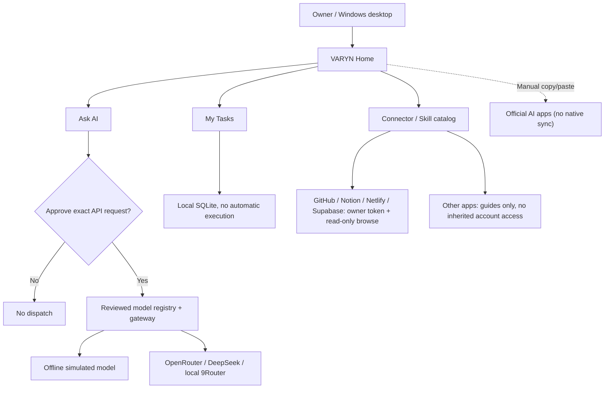

# VARYN

**A local-first AI workspace with human-approved model routing, persistent tasks, and experimental multi-model workflows.**

[](https://github.com/naraya07pedro-spec/VARYN/releases/tag/v0.1.0-alpha.10)
[](https://github.com/naraya07pedro-spec/VARYN/actions/runs/42236882600)
[](LICENSE)


> **Public experimental alpha, not production software.** VARYN provides a local Windows chat workspace, owner-approved LLM calls, a local task tracker, **explicit ChatGPT-export memory import encrypted with Windows DPAPI**, and a manually configured **owner-only Telegram Bot API channel**. All third-party credentials must be configured independently. It does **not** offer autonomous tasks, inherited ChatGPT integrations, WhatsApp connectivity, or native two-way consumer-chat synchronization.

### [Download Windows Alpha 10](https://github.com/naraya07pedro-spec/VARYN/releases/download/v0.1.0-alpha.10/VARYN-Windows-x64-v0.1.0-alpha.10-unsigned.zip) · [Release notes](https://github.com/naraya07pedro-spec/VARYN/releases/tag/v0.1.0-alpha.10) · [Browse full alpha source](https://github.com/naraya07pedro-spec/VARYN/tree/v0.1.0-alpha.10) · [Development PR](https://github.com/naraya07pedro-spec/VARYN/pull/1)

## Why VARYN?

Working with multiple AI models raises practical questions: What data is leaving the machine? Which model is selected? What might a request cost? Which tasks and permissions belong to the owner? VARYN explores these problems as an open-source desktop project, without claiming to control accounts or tools it has not actually connected.

## A natural, multilingual workspace

Based on real user-device feedback, VARYN's latest Windows home removes the previous decorative mountain banner and generic AI-themed cards. The new **warm, editorial layout** places a familiar chat composer, a clear navigation sidebar, and working task/app shortcuts ahead of technical configuration.

**English is the default UI language.** Change it directly from the header or Settings to **Bahasa Indonesia, Español, or Français**. Your choice is saved locally; existing tasks and the current chat remain open when you switch. Advanced legacy developer views and third-party replies may remain in their original language.

**Maximize and resize are supported.** Unlike the earlier window treated as a transient dialog, the Alpha 10 owner home starts maximized on Windows and has both native window controls and an obvious Maximize / Restore button. The interface uses standard system typography without downloaded images, stock illustrations or robotic visual themes.

The app remains an experimental API gateway with explicit per-request approvals; **no automatic task execution, verified third-party OAuth connectors, native consumer-chat sync, or production security guarantee** is implied.

## Apps that can actually connect

Alpha 10 replaces faux letter badges with **20 offline brand-mark images** sourced from licensed icon collections, including GitHub, Telegram, WhatsApp, Gmail, Google, Netlify, Supabase, Canva, and Notion. Artwork is packaged inside the Windows EXE, not downloaded from icon servers; brand identification is **not endorsement or proof of connected accounts**. [Third-party artwork and licenses](https://github.com/naraya07pedro-spec/VARYN/blob/v0.1.0-alpha.10/assets/BRAND-LICENSES.md).

**Four real account-verified read-only adapters:** GitHub, Notion, Netlify and Supabase. From **Apps**, click **Connect → Create token → paste your own provider token → Connect**. VARYN validates it against the provider's official API and only then displays *Connected*. **Browse** lists accessible resources on deliberate request; **Disconnect** discards the credential from session RAM. Provider-issued tokens may grant broad permissions even though VARYN only uses read-only requests. Prefer limited scopes.

**Telegram** has separate BotFather token + numeric owner ID setup. **WhatsApp, Gmail, Google Calendar, Drive, LinkedIn and other listed apps are NOT connected**. Their **Official guide** action now opens actual provider documentation in one click, or **Request connector** opens an issue draft when no guide exists. This is not OAuth or inherited ChatGPT plugin access.

**Model selection:** Open **Browse AI models**. View the OpenRouter public catalog without a key when the provider permits, use the $0-reported-prices filter if desired, then paste your API key, select a model, check prices, and confirm the request. DeepSeek requires its own key for model listing. A catalog listing or zero-priced snapshot **never guarantees credits, free inference, eligibility or live access**. The old separate technical controller is hidden.

[Complete Alpha 10 setup and security boundaries](https://github.com/naraya07pedro-spec/VARYN/blob/v0.1.0-alpha.10/docs/ALPHA10-APP-LOGOS-AND-SETUP.md).

## Memory import and Telegram bot

**Memory, not pretend sync.** Open **Memory** in the left navigation, select the ChatGPT ZIP downloaded from **ChatGPT → Settings → Data controls → Export data**, choose the conversations you actually want to retain, and approve the local import. Selected plain-text excerpts are stored in a Windows-user-bound **DPAPI encrypted vault**. Use local search to find a conversation and insert a reviewed excerpt into chat, or check **Use saved memory** for a one-time retrieval before sending. Imported context is **untrusted reference material**, never automatically uploaded or treated as instructions. This pilot limits export files and vault capacity; it does not recreate your ChatGPT Memory summary, maintain always-on synchronization, or provide full semantic retrieval.

**Telegram bot, not just a catalog item.** In **Apps**, configure a bot token from Telegram **@BotFather** and your *numeric Telegram user ID*. First configure a real OpenRouter/DeepSeek model and API key locally in the chat. Press **Connect Telegram**; the desktop uses the official Telegram Bot API and will only respond to the allowlisted owner's private DM. To use a model, send `/ask Your question`, inspect the complete preview, then send `/confirm CODE` within two minutes to approve **one** request. The bot ignores unknown senders/groups and runs only **while the desktop is open**. No auto-retries or 24/7 service; external provider charges can apply. Disconnect in the application to stop polling.

**WhatsApp is NOT connected.** A real WhatsApp integration needs separate official Meta Cloud API credentials, a business-enabled number and an HTTPS webhook. VARYN does not inherit messaging accounts from ChatGPT or Hermes.

[Implementation scope, privacy constraints and setup instructions](https://github.com/naraya07pedro-spec/VARYN/blob/v0.1.0-alpha.10/docs/OWNER-MEMORY-TELEGRAM.md)

## What works in Alpha 10

| Capability | Available behavior |
| --- | --- |
| **AI Chat** | OpenRouter/DeepSeek model picker, search, current provider-reported price snapshot, RAM-only API key, explicit one-request approval, offline simulated mode |
| **Memory** | Manually import user-selected ChatGPT export excerpts to a Windows DPAPI local vault; owner-controlled search and context insertion |
| **Tasks** | Create, view, pause and complete local SQLite tasks; no autonomous execution or notifications |
| **Apps** | Working read-only account checks and resource lists for GitHub, Notion, Netlify and Supabase; independent credentials required |
| **Telegram** | Owner-only Bot API polling, per-request /ask + /confirm, works only while the PC and app remain running |
| **Other providers** | Official setup documentation or feature-request links; no false connected status |
| **Windows** | Native resizable single workspace, English default with 3 optional UI languages, authentic locally bundled brand icons |

No native ChatGPT/Claude/Gemini consumer-history synchronization, WhatsApp integration, cloud gateway, autonomous agents or inherited ChatGPT plugins are provided.

## Get started on Windows

1. Download [**VARYN Alpha 10 portable Windows ZIP**](https://github.com/naraya07pedro-spec/VARYN/releases/download/v0.1.0-alpha.10/VARYN-Windows-x64-v0.1.0-alpha.10-unsigned.zip).
2. Verify the release ZIP SHA-256 (optional command in standard PowerShell, no administrator rights required):

   ```powershell
   (Get-FileHash .\VARYN-Windows-x64-v0.1.0-alpha.10-unsigned.zip -Algorithm SHA256).Hash.ToLowerInvariant()
   ```

   Expected: `b072720743ee2f04108c9d2404adbe192637e30a0815ccc20e0782fc413a93e7`.

3. Extract the **entire ZIP to a new folder**, keeping the EXE, `_internal/` runtime and bundled assets together.
4. Double-click **VARYN-Portable.exe** as a normal, non-administrator Windows user. PowerShell scripts and Python installation are **not required** for ordinary GUI use.
5. In **Home**, click **Browse AI models** to select OpenRouter or DeepSeek, choose a model and paste your own provider API key. Confirm permission and the exact outgoing prompt for each call. In **Apps**, click **Connect** only on supported accounts. Telegram requires your own bot token and numeric user ID.

**Security:** The ZIP and executable are **unsigned, experimental software**. Never disable Defender or SmartScreen to force execution. Token scopes from the provider may be broader than VARYN's own read-only actions. Do not import sensitive customer data without explicit permission. Estimated prices are not billing limits. Real provider logins have not been verified on the owner's PC.

## How it fits together



## Architecture, development, and contributing

**Why does `main` only contain the project entry point?** The full experimental implementation was developed on a long-running **draft PR #1** and is preserved in the **[v0.1.0-alpha.10 release tag](https://github.com/naraya07pedro-spec/VARYN/tree/v0.1.0-alpha.10)**. A public release does **not** imply that all experimental work has been merged into the default branch. To inspect or build the app source, select the release tag rather than cloning the `main` stub.

- [Architecture and trust boundaries](https://github.com/naraya07pedro-spec/VARYN/blob/v0.1.0-alpha.10/docs/ARCHITECTURE.md)
- [Task, connector, plugin, and skill limitations](https://github.com/naraya07pedro-spec/VARYN/blob/v0.1.0-alpha.10/docs/TASKS-CONNECTORS-SKILLS.md)
- [Alpha 10 owner setup and product scope](https://github.com/naraya07pedro-spec/VARYN/blob/v0.1.0-alpha.10/docs/OWNER-HOME-ALPHA2.md)
- [Contribution guidelines](https://github.com/naraya07pedro-spec/VARYN/blob/v0.1.0-alpha.10/CONTRIBUTING.md) and [security policy](https://github.com/naraya07pedro-spec/VARYN/blob/v0.1.0-alpha.10/SECURITY.md)
- [Verified Windows + Ubuntu + Portable + Release pipeline](https://github.com/naraya07pedro-spec/VARYN/actions/runs/42236882600)
- [Report a reproducible issue](https://github.com/naraya07pedro-spec/VARYN/issues)

## Roadmap

**Next meaningful milestones:** first verified owner-PC model call, scoped real OAuth connectors, task-to-tool execution with durable idempotent checkpoints, and honest end-to-end demonstrations. Automatic two-way conversation-history synchronization in consumer AI apps remains **externally unverified**, not a shipped capability.

If the project's implementation or permission model interests you, **star the repository to follow its progress**. Real installation feedback and reproducible issues are more useful than artificial engagement.

**Author:** Evan Naraya · **License:** [MIT](LICENSE). VARYN is independent and is not affiliated with OpenAI, Anthropic, Google, OpenRouter, or other integration providers.
