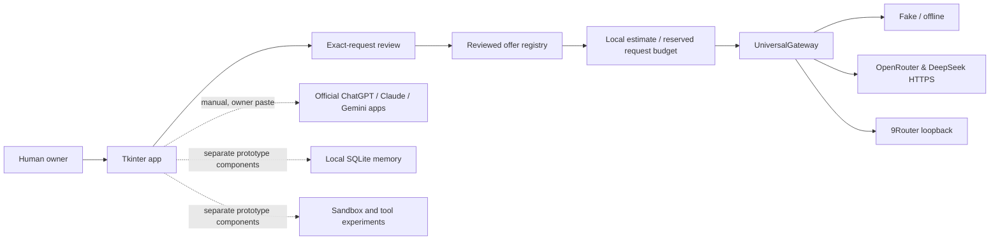

# Architecture and trust boundaries (development snapshot)

**As of 2026-11-06.** This describes the experimental draft PR #1 at commit `b52a774241825f596fc0ccb063de190a9b520994`, not the minimal public main branch.

## What is connected

- Desktop model control center chooses a reviewed offer and shows the exact typed prompt in a consent window.
- `varyn/gateway_chat.py` prepares single-message, bounded, OpenAI-style chat completion requests to pinned endpoints. It cannot read logged-in browser sessions.
- `varyn/universal_gateway.py` requires the network capability, a provider environment credential, an explicitly reviewed request, and a local estimated budget reservation. A real task requires an additional opt-in. Inference is a single request, not an autonomous multi-step agent.
- The desktop keeps the resulting reply in volatile UI state. Model catalogue discovery is a separate owner-approved GET.
- The manual relay workbench can open official provider homepages after consent and prepare packets for owner-mediated copy/paste. It cannot authenticate or edit native consumer-app history.

## What remains unintegrated

- Unified multi-step orchestration linking memory, approved external actions, and model selection.
- Owner-device external-provider acceptance; actual external authorization/account balance/charges are unknown.
- Production secret storage, encrypted end-to-end shared memory, data retention guarantees, multi-tenant permissions, sandbox security and signed Windows distribution.
- Automatic bidirectional synchronization of official ChatGPT, Claude and Gemini consumer histories/memories. **Option C is not achieved.**

## Privacy and cost hazards

The outgoing prompt may be stored and processed by the model provider under its own terms. Never put secrets in public reports or real requests. VARYN's keyword-pattern secret preflight is not comprehensive DLP. Billing estimates depend on user-entered prices; they are not provider limits.

The 9Router endpoint is pinned to local loopback but 9Router can choose an upstream independently. Its explicit upstream authorization gate is necessary, not sufficient to prove upstream identity.

## Evidence

- [Implementation & review PR](https://github.com/naraya07pedro-spec/VARYN/pull/1)
- [Windows/Ubuntu CI and Portable artifact run](https://github.com/naraya07pedro-spec/VARYN/actions/runs/42162535996)
- [Model control center](model-control-center-17s-40.md)
- [Real owner tasks](real-model-tasks-17s-46.md)
- [Product goal vs official app sync](product-contract-and-feasibility.md)
